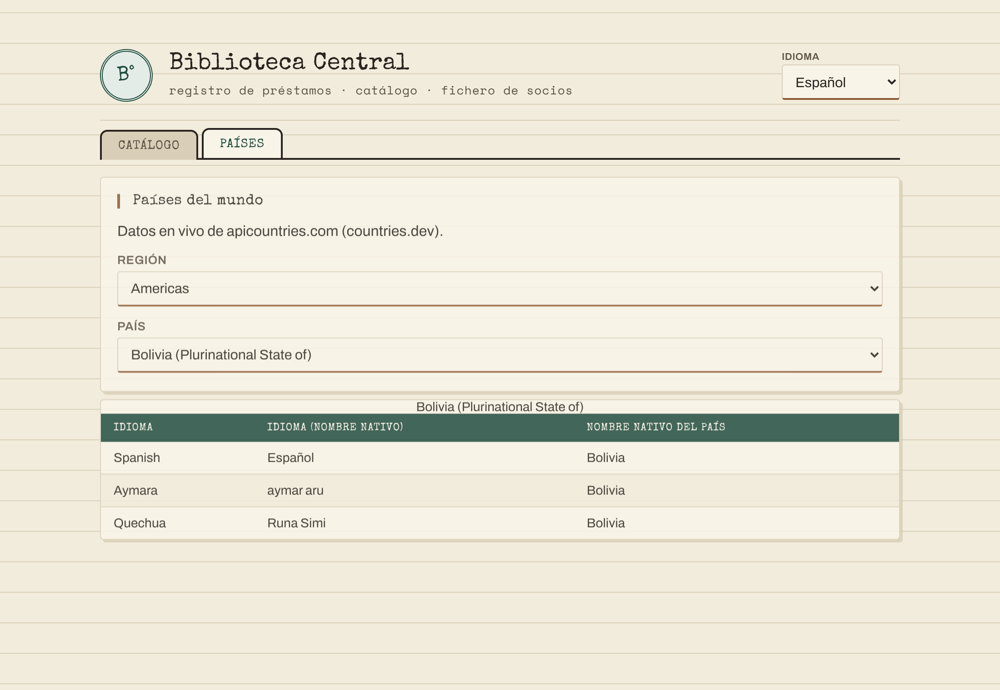

# Avance del proyecto final — Biblioteca Central (arquitectura n-capas)

Sistema de gestión de préstamos de biblioteca. Este documento explica, sobre
el código, el estado de las tecnologías pedidas en el curso y de lo que se
agregó por cuenta propia. Actualizado al 24/11/2026.

| # | Tecnología | Estado | Detalle |
|---|------------|--------|---------|
| 1 | Funciones stateful y stateless | Funcionando | §1 |
| 2 | Internacionalización | Funcionando (4 idiomas) | §2, [i18n.md](i18n.md) |
| 3 | Validación front-end y back-end | Funcionando | §3, [validacion-regex.md](validacion-regex.md) |
| 4 | Web Sockets (catálogo en vivo) | Funcionando y desplegado | §4, [websocket-catalogo-en-vivo.md](websocket-catalogo-en-vivo.md) |
| 5 | JWT y servicios web (bearer token) | Funcionando y desplegado | §5, [jwt-servicios-web.md](jwt-servicios-web.md) |
| 6 | Llamadas asíncronas (vista Países) | Funcionando y desplegado | §6 |
| 7 | Web Workers (búsqueda del catálogo) | Funcionando y desplegado | §7, [web-worker-catalogo.md](web-worker-catalogo.md) |
| 8 | Integración continua y despliegue remoto | Funcionando | §8, [despliegue-remoto.md](despliegue-remoto.md) |
| 9 | Seguridad en producción (CORS, límite de intentos) | Funcionando | §9, [auditoria-produccion.md](auditoria-produccion.md) |
| 10 | Actividades aisladas: pruebas paralelas, RabbitMQ, stream de objetos | Terminadas | §10 |

---|------------|--------|
| 1 | Funciones stateful y stateless | Funcionando |
| 2 | Internacionalización | Funcionando (4 idiomas) |
| 3 | Validación front-end y back-end | Funcionando |
| 4 | Web Sockets | **En implementación** |

---

## 0. Arquitectura n-capas

El backend (Node + TypeScript + Express) está separado en tres capas, y cada
una solo conoce a la que tiene debajo:

```
backend/src/
  presentation/     ← HTTP: rutas, controladores, DTOs, middleware
    routes/  controllers/  dtos/  middleware/  realtime/
  domain/           ← reglas de negocio, sin Express ni SQL
    entities/  services/  interfaces/  errors/  validation/  i18n/
  infrastructure/   ← acceso a datos
    database/  repositories/   (SQLite local y Postgres en producción)
frontend/           ← cliente (HTML + JS sin bundler), despliegue aparte
```

- **Presentación** recibe el request, revisa la forma del body y delega. No
  contiene reglas de negocio.
- **Dominio** contiene los servicios (`LoanService`, `BookService`,
  `UserService`, `AuthService`, …). Depende de **interfaces**
  (`IBookRepository`, `ILoanRepository`, …), no de una base de datos concreta.
- **Infraestructura** implementa esas interfaces dos veces: `Sqlite*Repository`
  y `Postgres*Repository`.

Las capas se conectan a mano en `backend/src/app.ts` (inyección de
dependencias por constructor, sin framework):

```ts
// Infraestructura: se elige la implementación según el entorno
if (process.env.DATABASE_URL) {
  const pool = await createPostgresPool();
  bookRepository = new PostgresBookRepository(pool);
  // ...
} else {
  const db = createDatabaseConnection();
  bookRepository = new SqliteBookRepository(db);
  // ...
}

// Dominio (Repositorio -> Servicio)
const bookService = new BookService(bookRepository);
const loanService = new LoanService(loanRepository, bookRepository, userRepository, debtRepository, settingsRepository);

// Presentación (Servicio -> Controlador -> Rutas)
const bookController = new BookController(bookService);
app.use("/api/v1", createBookRoutes(bookController, authSecret));
```

Como los servicios solo ven la interfaz, cambiar de SQLite a Postgres no
tocó una sola línea del dominio.

---

## 1. Funciones stateless y stateful

**Criterio usado:**

- **Stateless:** el resultado depende solo de los argumentos. No lee ni
  escribe base de datos, disco, red ni variables globales. Mismo input →
  mismo output.
- **Stateful:** el resultado depende de, o modifica, estado persistente (las
  tablas). La misma llamada puede dar resultados distintos según lo guardado.

### 1.1 Stateless — `calculateFine`

`backend/src/domain/services/LoanService.ts`

```ts
export function calculateFine(dueDate: Date, asOfDate: Date, hourlyRate: number, multiplier: number): number {
  if (asOfDate <= dueDate) return 0;
  const hoursLate = Math.ceil((asOfDate.getTime() - dueDate.getTime()) / (1000 * 60 * 60));
  return Math.round(hoursLate * hourlyRate * multiplier);
}
```

Calcula la multa por atraso. No consulta `loans` ni `debts` y no llama a
`Date.now()`: la fecha, la tarifa y el multiplicador llegan como argumentos.
Por eso la misma función sirve para dos cosas distintas: la multa real al
devolver (`returnLoan` le pasa la fecha de devolución) y la multa
*provisional* que se muestra en pantalla (`getAllLoans` le pasa "ahora", sin
crear ninguna deuda).

### 1.2 Stateless — `verifyToken`

`backend/src/domain/services/authTokens.ts`

```ts
export function verifyToken(token: string, secret: string, now = Date.now()): TokenPayload | null {
  const [payload, sig] = token.split(".");
  if (!payload || !sig) return null;

  const expectedSig = hmac(payload, secret);
  const a = Buffer.from(sig);
  const b = Buffer.from(expectedSig);
  if (a.length !== b.length || !timingSafeEqual(a, b)) return null;

  try {
    const data = JSON.parse(fromB64url(payload).toString("utf8")) as TokenPayload;
    if (typeof data.exp !== "number" || data.exp < now) return null;
    return data;
  } catch {
    return null;
  }
}
```

Valida la sesión con puro cálculo: recalcula la firma HMAC-SHA256 y revisa
la expiración. **No existe tabla de sesiones**: el id de la cuenta, el rol y
el vencimiento (`sub`, `role`, `exp`) viajan firmados dentro del token. El
reloj se inyecta como parámetro `now` para que siga siendo determinista.

La usa el middleware `requireAuth` en **cada** request protegido, sin tocar
la base de datos:

```ts
// backend/src/presentation/middleware/requireAuth.ts
const token = (req.headers.authorization ?? "").replace(/^Bearer\s+/i, "");
const payload = verifyToken(token, secret);
if (!payload) {
  res.status(401).json({ code: "AUTH_REQUIRED", error: t("AUTH_REQUIRED", req.locale) });
  return;
}
if (roles.length > 0 && !roles.includes(payload.role)) {
  res.status(403).json({ code: "AUTH_FORBIDDEN", error: t("AUTH_FORBIDDEN", req.locale) });
  return;
}
```

En el mismo módulo hay otras funciones puras de apoyo: `signToken`,
`hashPassword` y `verifyPassword`. También son stateless el traductor
`t()` (sección 2) y los validadores `isValidEmail` / `isValidName`
(sección 3).

### 1.3 Stateful — `LoanService.createLoan`

`backend/src/domain/services/LoanService.ts` (resumido)

```ts
async createLoan(userId: string, bookId: string): Promise<Loan> {
  const user = await this.userRepository.findById(userId);             // LEE
  if (!user) throw new BusinessError("USER_NOT_FOUND");
  if (user.status === "INACTIVE") throw new BusinessError("USER_INACTIVE");

  if (await this.debtRepository.hasUnpaidByUserId(userId)) {           // LEE
    throw new BusinessError("USER_HAS_UNPAID_DEBT");
  }

  const settings = await this.settingsRepository.get();                // LEE
  const userLoans = await this.loanRepository.findByUserId(userId);    // LEE
  // ...bloquea si hay un préstamo vencido o si se alcanzó settings.maxActiveLoans...

  const availableCopy = await this.bookRepository.findAvailableCopy(bookId);  // LEE
  if (!availableCopy) throw new BusinessError("BOOK_NO_COPIES_AVAILABLE");

  await this.bookRepository.setCopyStatus(availableCopy.id, "LOANED");        // ESCRIBE
  return this.loanRepository.create({ userId, bookCopyId: availableCopy.id, /* ... */ status: "ACTIVE" }); // ESCRIBE
}
```

Todo su comportamiento depende del estado guardado (¿existe el socio?,
¿tiene deudas?, ¿cuántos préstamos activos?, ¿quedan copias?) y además lo
modifica: marca una copia como `LOANED` e inserta una fila en `loans`.
Llamarla dos veces con los mismos argumentos da resultados distintos: la
segunda puede fallar por falta de copias o por el límite de préstamos.

### 1.4 Stateful — `AuthService.register` / `login`

`backend/src/domain/services/AuthService.ts`

```ts
async register(email: string, password: string, requestedRole?: string): Promise<AuthResult> {
  const normalizedEmail = email.trim().toLowerCase();
  if (!isValidEmail(normalizedEmail)) throw new BusinessError("EMAIL_INVALID");
  if (password.length < 6) throw new BusinessError("PASSWORD_TOO_SHORT");
  if (await this.accountRepository.findByEmail(normalizedEmail)) {        // LEE
    throw new BusinessError("ACCOUNT_EMAIL_TAKEN");
  }

  const isFirstAccount = (await this.accountRepository.countAll()) === 0;  // LEE
  const role = this.resolveRole(requestedRole, isFirstAccount);

  const created = await this.accountRepository.create({                    // ESCRIBE
    email: normalizedEmail,
    passwordHash: hashPassword(password, newSalt()),
    role,
    createdAt: new Date(),
  });
  return this.buildResult(created); // { account, token }
}
```

`register` escribe en la tabla `accounts`, y su resultado depende de lo que
ya hay: la primera cuenta registrada queda como `ADMINISTRADOR`, las demás
como `USUARIO` (o `BIBLIOTECARIO` si se pide). `login` lee esa misma tabla y
compara el hash guardado.

### 1.5 Cómo se combinan

La autenticación muestra bien la división: lo que necesita la base de datos
es stateful y ocurre **una vez** (al registrarse o iniciar sesión); lo que
ocurre en **cada request** es stateless.

| Parte | Función | Tipo |
|-------|---------|------|
| Alta y búsqueda de cuentas | `AuthService.register` / `login` | Stateful |
| Hash de contraseña, firma y verificación del token | `hashPassword`, `signToken`, `verifyToken` | Stateless |
| Crear un préstamo | `LoanService.createLoan` | Stateful |
| Calcular la multa | `calculateFine` | Stateless |

---

## 2. Internacionalización (i18n)

Idiomas: **español** (base), **inglés**, **árabe** (derecha a izquierda) y
**francés**. La idea central es que ni el dominio ni el HTML tienen texto
fijo: todo es una *clave* que se resuelve contra un catálogo JSON por
idioma. Backend y frontend aplican el mismo patrón por separado, porque se
despliegan por separado.

### 2.1 Backend

**Los errores llevan un código, no un mensaje.**
`backend/src/domain/errors/BusinessError.ts`:

```ts
export class BusinessError extends Error {
  constructor(
    public readonly code: string,
    public readonly params?: Record<string, string | number>
  ) {
    super(code);
    this.name = "BusinessError";
  }
}
```

El dominio lanza, por ejemplo,
`new BusinessError("LOAN_MAX_ACTIVE", { max: 3, count: 3 })` y no sabe en
qué idioma se va a mostrar.

**El middleware decide el idioma del request.**
`backend/src/presentation/middleware/locale.ts`:

```ts
export const resolveLocale: RequestHandler = (req, _res, next) => {
  const fromQuery = typeof req.query.lang === "string" ? req.query.lang.toLowerCase() : undefined;
  if (fromQuery && isSupported(fromQuery)) {
    req.locale = fromQuery;
    next();
    return;
  }

  const header = req.headers["accept-language"];
  const candidates = typeof header === "string" ? header.split(",").map((c) => c.trim().slice(0, 2).toLowerCase()) : [];
  req.locale = candidates.find(isSupported) ?? DEFAULT_LOCALE;
  next();
};
```

Prioridad: `?lang=` → cabecera `Accept-Language` → español. Se registra
antes de las rutas (`app.use(resolveLocale)`), así todo controlador ya tiene
`req.locale`.

**El traductor.** `backend/src/domain/i18n/t.ts`:

```ts
export function t(code: string, locale: Locale, params?: Record<string, string | number>): string {
  const catalog = CATALOGS[locale] ?? CATALOGS[DEFAULT_LOCALE];
  const entry = catalog[code] ?? CATALOGS[DEFAULT_LOCALE][code];
  if (!entry) return code; // clave desconocida: mejor mostrar el código que romper

  if (isMt(entry)) return interpolate(entry.text, params);

  if (isPlural(entry)) {
    const count = Number(params?.count ?? 0);
    const rule = new Intl.PluralRules(locale).select(count);
    const form = rule === "one" ? entry.one : undefined;
    return interpolate(form ?? entry.other, params);
  }

  return interpolate(entry, params);
}
```

Soporta tres tipos de entrada en `locales/{es,en,ar,fr}.json`:

- Texto simple con **placeholders**: `"{max} préstamos"`.
- **Plurales** `{ one, other }`, resueltos con `Intl.PluralRules` (nativo,
  sin librería).
- `{ text, mt: true }`: traducción automática pendiente de revisión.

Si una clave falta en el idioma pedido, cae al español; si tampoco existe,
devuelve el código en vez de fallar.

**Un solo lugar traduce y elige el status HTTP.**
`backend/src/presentation/controllers/handleBusinessError.ts`:

```ts
export function handleBusinessError(res: Response, error: unknown, locale: Locale): void {
  if (error instanceof BusinessError) {
    const status = error.code.endsWith("_NOT_FOUND") ? 404 : 422;
    res.status(status).json({ code: error.code, error: t(error.code, locale, error.params) });
    return;
  }
  console.error(error);
  res.status(500).json({ code: "INTERNAL_ERROR", error: t("INTERNAL_ERROR", locale) });
}
```

El status se decide por **código**, no comparando texto. La respuesta trae
ambos: `{"code":"AUTH_REQUIRED","error":"Connexion requise."}`.

### 2.2 Frontend

Dos archivos, separados justamente por stateless / stateful:

- **`frontend/format.js`** — funciones puras: `translate`, `interpolate`,
  `formatCurrency`, `convertAmount`, `formatDate`. Sin DOM ni red, por eso
  se prueban con `node --test`.
- **`frontend/i18n.js`** — la parte con estado: idioma activo, catálogo
  cargado, tasas de cambio, `localStorage`.

**Idioma inicial**: el guardado, si no el del navegador, si no español.

```js
function detectInitialLocale() {
  const stored = localStorage.getItem(STORAGE_KEY);
  if (stored && SUPPORTED.includes(stored)) return stored;
  const browser = (navigator.language || "es").slice(0, 2).toLowerCase();
  return SUPPORTED.includes(browser) ? browser : DEFAULT_LOCALE;
}
```

**El HTML no tiene texto fijo.** Cada elemento declara su clave en un
atributo y `translateDom()` lo rellena:

```html
<input id="catalogSearch" type="text" data-i18n-placeholder="catalog.searchPlaceholder">
<div class="tabs" role="tablist" data-i18n-aria-label="nav.tablist">
```

```js
function translateDom() {
  document.querySelectorAll("[data-i18n]").forEach((el) => {
    el.textContent = t(el.getAttribute("data-i18n"));
  });
  // Atributos: data-i18n-placeholder="key", data-i18n-aria-label="key", etc.
  document.querySelectorAll("*").forEach((el) => {
    for (const attr of el.attributes) {
      if (attr.name.startsWith("data-i18n-")) {
        const target = attr.name.replace("data-i18n-", "");
        el.setAttribute(target, t(attr.value));
      }
    }
  });
}
```

Las etiquetas de accesibilidad (`aria-label`) salen del mismo catálogo, así
que un lector de pantalla también las lee en el idioma elegido.

**Dirección del texto (RTL).** La dirección de cada idioma está en
`locales/meta.json`, no escrita en el código:

```js
function applyDirection(locale) {
  const dir = (meta[locale] && meta[locale].dir) || "ltr";
  document.documentElement.lang = locale;
  document.documentElement.dir = dir;
}
```

El CSS usa propiedades lógicas (`padding-inline-start`, `text-align: start`)
en lugar de `left`/`right`, así que al poner `dir="rtl"` todo el layout se
espeja sin reglas especiales para árabe.

**Fechas, números y moneda.** El backend siempre entrega fechas en UTC y
montos en soles (PEN); el formato es responsabilidad del cliente, con las
APIs nativas `Intl`:

```js
// format.js (puro)
function formatCurrency(amount, locale, currency = BASE_CURRENCY) {
  return new Intl.NumberFormat(locale, { style: "currency", currency }).format(amount);
}
function formatDate(iso, locale, timeZone) {
  return new Intl.DateTimeFormat(locale, { dateStyle: "medium", timeZone }).format(new Date(iso));
}
```

La moneda no solo cambia de símbolo, se convierte (es → PEN, en/ar → USD,
fr → EUR). `i18n.js` pide la tasa a una API pública, la guarda 6 horas en
`localStorage` y, si falla, muestra el monto real en soles en vez de
inventar una conversión:

```js
function formatCurrency(amount) {
  const rate = ratesFromPEN[currentCurrency];
  if (rate === undefined) {
    return I18nFormat.formatCurrency(amount, currentLocale, I18nFormat.BASE_CURRENCY);
  }
  return I18nFormat.formatCurrency(I18nFormat.convertAmount(amount, rate), currentLocale, currentCurrency);
}
```

**Front y back hablan el mismo idioma.** Cada llamada a la API manda el
idioma activo, y los errores se traducen por código:

```js
// index.html — fetchJson
const res = await fetch(API_BASE_URL + path + sep + 'lang=' + getLocale(), { ...options, headers });

// i18n.js
function translateError(data) {
  if (!data) return t("common.unexpectedError");
  if (data.code && catalog["errors." + data.code] !== undefined) {
    return t("errors." + data.code);
  }
  return data.error || t("common.unexpectedError");
}
```

### 2.3 Controles automáticos

- `backend/src/domain/i18n/completeness.test.ts`: todo código de
  `BusinessError` usado en el dominio tiene traducción.
- `backend/src/domain/i18n/placeholders.test.ts`: cada traducción usa los
  mismos `{placeholders}` que el texto base.
- `npm run i18n:check`: compara claves y placeholders de todos los idiomas
  (backend y frontend) contra el español y falla si falta algo.
- `npm run i18n:translate`: completa las claves faltantes con una API de
  traducción y las marca `mt: true`.

---

## 3. Validación front-end y back-end

Se valida en dos lugares con objetivos distintos:

- **Front-end:** respuesta inmediata al usuario, sin viaje de red. Es
  comodidad, no seguridad.
- **Back-end:** es la autoridad. Cualquiera puede llamar a la API
  directamente y saltarse el navegador, así que nunca se confía en el
  cliente.

### 3.1 Front-end

`frontend/validators.js` define las reglas como expresiones regulares:

```js
const EMAIL_RE = /^[^\s@]+@[^\s@]+\.[^\s@]+$/;
const PASSWORD_RE = /^(?=.*[A-Za-z])(?=.*\d).{6,}$/;   // 6+ caracteres, letra y número
const NAME_RE = /^[\p{L}\s'.,-]{2,60}$/u;              // letras de cualquier alfabeto, 2 a 60
const NON_NEGATIVE_INTEGER_RE = /^\d+$/;               // rechaza "1.5" y "1e3"

const isValidEmail = (value) => EMAIL_RE.test(String(value).trim());
const isValidPassword = (value) => PASSWORD_RE.test(String(value));
const isValidName = (value) => NAME_RE.test(String(value).trim());
const isNonNegativeInteger = (value) => NON_NEGATIVE_INTEGER_RE.test(String(value).trim());
```

| Regla | Campo | Qué bloquea |
|-------|-------|-------------|
| `isValidEmail` | Email (login, registro, socio) | Sin `@`, sin dominio, con espacios |
| `isValidPassword` | Contraseña (solo registro) | Menos de 6 caracteres, o sin letra + número |
| `isValidName` | Nombre de socio | Dígitos, símbolos, longitud fuera de 2–60 |
| `isNonNegativeInteger` | Copias iniciales / stock | Decimales, negativos, notación científica |

En `index.html` un único helper las aplica **antes** de llamar a la red:

```js
function validateField(value, check, messageKey, resultEl) {
  if (check(value)) return true;
  showResult(resultEl, false, t(messageKey));
  return false;
}

// registro
if (!validateField(email, isValidEmail, 'validation.emailInvalid', authResultEl)) return;
if (!validateField(password, isValidPassword, 'validation.passwordWeak', authResultEl)) return;
// recién acá se llama a fetchJson(...)
```

El mensaje sale del catálogo i18n (`validation.*`), así que el error de
validación también aparece en el idioma activo.

### 3.2 Back-end

Se valida en dos niveles, uno por capa.

**Nivel 1 — Presentación: forma del body → `400`.** El controlador revisa
que los campos existan y sean del tipo correcto antes de llamar al servicio:

```ts
// backend/src/presentation/controllers/BookController.ts
create = async (req: Request, res: Response): Promise<void> => {
  const { title, author, initialCopies, coverUrl, publishYear } = req.body as CreateBookDto;

  if (typeof title !== "string" || typeof author !== "string" || typeof initialCopies !== "number") {
    badRequest(res, req.locale, "BODY_BOOK_CREATE_INVALID");
    return;
  }
  // ...
};
```

Lo mismo hacen `AuthController` (`BODY_AUTH_INVALID`) y `UserController`
(`BODY_USER_INVALID`, `BODY_STATUS_INVALID`).

**Nivel 2 — Dominio: formato y reglas de negocio → `422` / `404`.**
`backend/src/domain/validation/patterns.ts` tiene las mismas expresiones
regulares que el front:

```ts
export const EMAIL_PATTERN = /^[^\s@]+@[^\s@]+\.[^\s@]+$/;
export const NAME_PATTERN = /^[\p{L}\s'.,-]{2,60}$/u;

export function isValidEmail(value: string): boolean {
  return EMAIL_PATTERN.test(value.trim());
}
export function isValidName(value: string): boolean {
  return NAME_PATTERN.test(value.trim());
}
```

Los servicios las usan y agregan lo que solo se puede saber consultando la
base de datos:

```ts
// backend/src/domain/services/UserService.ts
private async validate(name: string, email: string, ignoreUserId?: string): Promise<void> {
  if (!isValidName(name)) throw new BusinessError("USER_NAME_REQUIRED");
  if (!isValidEmail(email)) throw new BusinessError("EMAIL_INVALID");
  const existing = await this.userRepository.findByEmail(email);
  if (existing && existing.id !== ignoreUserId) throw new BusinessError("USER_EMAIL_TAKEN");
}
```

```ts
// backend/src/domain/services/BookService.ts
const MAX_STOCK_QUANTITY = 10_000;

const isValidQuantity = (value: number): boolean =>
  Number.isInteger(value) && Number.isFinite(value) && value >= 0 && value <= MAX_STOCK_QUANTITY;

const isValidPublishYear = (value: number): boolean =>
  Number.isInteger(value) && value >= MIN_PUBLISH_YEAR && value <= new Date().getFullYear() + 1;
```

El tope de 10 000 existe solo en el backend: protege contra un request
directo con una cantidad enorme, algo que el formulario nunca enviaría.

### 3.3 Por qué las reglas están en los dos lados

Las expresiones regulares de email y nombre están duplicadas a propósito:
navegador y servidor son dos entornos sin build compartido. Hay dos
diferencias intencionales:

- La **contraseña** es más estricta en el front (letra + número) que en el
  back (solo longitud ≥ 6), y solo en el registro, para no bloquear el login
  de cuentas ya creadas.
- La **unicidad** del email y los **límites** de stock solo existen en el
  back, porque dependen de la base de datos o son medidas de seguridad.

Recorrido de un dato inválido:

| Dónde se detecta | Respuesta |
|------------------|-----------|
| `validators.js` (navegador) | Mensaje inmediato, no sale ningún request |
| Controlador (forma del body) | `400` + código `BODY_*` |
| Servicio (formato / negocio) | `422` + código (`EMAIL_INVALID`, `USER_EMAIL_TAKEN`, …) |
| Servicio (recurso inexistente) | `404` + código `*_NOT_FOUND` |

En los tres casos del servidor la respuesta es `{ code, error }` con el
mensaje ya traducido al idioma del request (sección 2).

### 3.4 Pruebas

- `backend/src/domain/validation/patterns.test.ts`: casos válidos e
  inválidos de email y nombre.
- `frontend/validators.test.js`: las cuatro reglas, incluidos `"1e3"` y
  `"1.5"`.
- `backend/src/domain/services/BookService.test.ts`: cantidades y año de
  publicación.

---

## 4. Web Sockets — catálogo en vivo

**Estado:** terminado, con pruebas (`catalogSocket.test.ts`) y desplegado en
Cloud Run. Documento completo con capturas:
[websocket-catalogo-en-vivo.md](websocket-catalogo-en-vivo.md).

Cuando alguien crea, edita, presta o devuelve un libro, los demás navegadores
conectados actualizan el catálogo solos. Un middleware de la capa de
presentación (`backend/src/presentation/realtime/catalogSocket.ts`, librería
`ws`) observa las peticiones que modifican libros o préstamos y, si terminaron
bien, envía `{"type":"catalog-changed"}` a todos los clientes. El WebSocket
comparte puerto con la API, en `/ws`.

**Decisión de diseño:** el mensaje no lleva datos. El navegador vuelve a pedir
el catálogo por la API normal, con su token, así que permisos y validación
siguen el mismo camino. La lista de clientes vive en memoria: con varias
instancias del backend habría que pasar el aviso por un canal compartido
(por ejemplo `LISTEN/NOTIFY` de Postgres).

---

## 5. JWT y servicios web

`POST /api/v1/auth/login` devuelve un **JWT HS256** estándar (RFC 7519) con
`sub`, `role`, `iat` y `exp` (8 h), firmado con `AUTH_SECRET`. Todos los
servicios de la API exigen `Authorization: Bearer <token>`; el middleware
`requireAuth` lo valida sin consultar la base (stateless): sin token o token
inválido → `401` con `WWW-Authenticate: Bearer`; rol sin permiso → `403`.
Se rechaza cualquier `alg` distinto de `HS256` y la firma se compara en tiempo
constante. Detalle y ejemplos con `curl`: [jwt-servicios-web.md](jwt-servicios-web.md).

---

## 6. Llamadas asíncronas — vista Países

Pestaña **Países** del frontend (`frontend/countries.js`): con `fetch` +
`async/await` pide los países de una región y luego el detalle del país
elegido (idiomas y su nombre nativo) a la API pública de
apicountries.com (`https://countries.dev`). Se usa esta API porque
`restcountries.com/v3.1` fue dado de baja. Las funciones de parseo son puras
y tienen pruebas (`countries.test.js`); los errores de red se muestran en la
vista sin romper la página.



---

## 7. Web Workers — búsqueda del catálogo

El filtrado del catálogo corre en `frontend/catalogWorker.js`, en un hilo
aparte: el catálogo se envía al worker una vez por carga y cada tecla solo
manda el texto. Cada búsqueda lleva un `id` para descartar respuestas viejas,
y si el navegador no soporta `Worker` se filtra en el hilo principal. La
búsqueda además ignora tildes. Detalle: [web-worker-catalogo.md](web-worker-catalogo.md).

---

## 8. Integración continua y despliegue remoto

Todo corre en GitHub Actions; no hace falta tener la laptop encendida.

| Workflow | Qué hace |
|---|---|
| `ci.yml` | Pruebas de backend y frontend en cada PR. |
| `deploy-backend.yml` | Al fusionar a `main`: aplica `schema.postgres.sql` en Supabase y despliega el backend en Cloud Run. |
| `deploy-frontend.yml` | Despliega el frontend como Cloudflare Worker. |
| `deploy-apps.yml` | Despliega cada app de `apps-secundarias/` con `package.json` en Cloud Run. |
| `supabase-keepalive.yml` | Consulta la base cada 3 días para que el plan gratis de Supabase no la pause. |
| `pruebas-paralelas.yml`, `rabbitmq-demo.yml` | Evidencia de las actividades aisladas (§10). |

Base de datos de producción: Postgres en Supabase. Guía de configuración:
[despliegue-remoto.md](despliegue-remoto.md).

---

## 9. Seguridad en producción

Resultado de la auditoría ([auditoria-produccion.md](auditoria-produccion.md)):

- **CORS** restringido al dominio del frontend (variable `CORS_ORIGINS`).
- **Límite de intentos** por IP: login 10 cada 15 min, registro 5 por hora
  (`429` con `Retry-After`).
- **Toda la API exige token** (el smoke test del despliegue verifica que
  `GET /api/v1/books` sin token responde `401`).
- **Cuentas de prueba eliminadas** de la base de producción (24/11/2026):
  se borraron las cuentas creadas durante las pruebas (`@example.com`,
  `demo-admin@biblioteca.test`; 7 en total, 2 de ellas administradoras) y la
  cuenta real del bibliotecario responsable pasó a ADMINISTRADOR, para que la
  app no quede sin administrador. La tabla `accounts` no tiene referencias
  desde préstamos ni deudas, así que no se perdió ningún dato de socios.

---

## 10. Actividades aisladas (`apps-secundarias/`)

Las actividades que no forman parte de la app viven aparte, sin compartir
código con ella:

| Carpeta | Actividad |
|---|---|
| `pruebas-paralelas/` | Ejecución paralela de pruebas con PyTest + pytest-xdist (por clases, suites y casos). |
| `rabbitmq-producer-consumer/` | Producer/Consumer del tutorial 1 de RabbitMQ en Python, con Docker. |
| `stream-objetos/` | Stream de objetos con `node:stream`, desplegado en Cloud Run. |

---

## 11. Cómo ejecutar y probar

```bash
cd backend
npm install
npm run dev         # API + frontend en http://localhost:3000 (SQLite local)
npm test            # dominio (multas, tokens, validación, i18n) y WebSocket
npm run i18n:check  # todos los idiomas completos y con placeholders correctos
```

```bash
cd frontend
npm test            # format, validators, catalog, openLibrary, countries
```

En producción no hace falta ejecutar nada: cada merge a `main` prueba y
despliega (§8).
