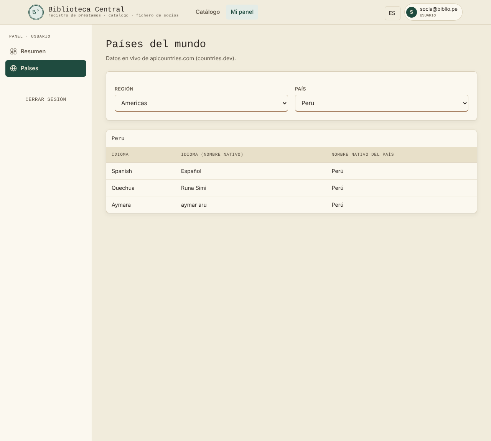

# Llamadas asíncronas: vista Países

Actividad del curso: *llamadas asíncronas*. Consumir una API pública con
`fetch` + `async/await`: elegir una región, cargar sus países y, al elegir un
país, mostrar sus idiomas con el nombre nativo.

- Sitio: <https://biblioteca-central.readuls.workers.dev> → **Iniciar sesión** →
  **Mi panel** → menú lateral **Países** (ruta `#/panel/paises`, visible para
  todos los roles con sesión).
- Código: [`frontend/countries.js`](../frontend/countries.js) (llamadas y
  parseo), [`frontend/app.js`](../frontend/app.js) (sección "Países") y
  pruebas en [`frontend/countries.test.js`](../frontend/countries.test.js).

## API usada

`restcountries.com/v3.1` (la del enunciado) fue dado de baja: responde
*"This API version has been deprecated"* y su v5 exige API key. Se usa la
alternativa que permite el enunciado, **apicountries.com**, hoy servida en
`https://countries.dev` (sin API key):

| Llamada | Endpoint | Para qué |
|---|---|---|
| 1 | `GET https://countries.dev/region/{region}` | Lista de países de la región elegida |
| 2 | `GET https://countries.dev/alpha/{código}` | Detalle del país: nombre nativo e idiomas |

Las regiones (`Africa`, `Americas`, `Asia`, `Europe`, `Oceania`, `Polar`) son
una lista fija, como permite el enunciado.

## Cómo funciona

```js
async function getJson(url) {
  const res = await fetch(url);                 // no bloquea la página
  if (!res.ok) throw new Error(`apicountries respondió ${res.status}`);
  return res.json();
}

async function fetchCountriesByRegion(region) {
  return parseCountryList(await getJson(`${API}/region/${encodeURIComponent(region)}`));
}

async function fetchCountryDetail(code) {
  const country = await getJson(`${API}/alpha/${encodeURIComponent(code)}`);
  return { name: country.name, nativeName: country.nativeName || "—", rows: parseLanguageRows(country) };
}
```

- Mientras espera la respuesta, el selector de país muestra "Cargando…" y
  queda deshabilitado; la página sigue respondiendo.
- **Respuestas fuera de orden:** cada consulta lleva un número
  (`countryRequest`). Si el usuario cambia de región o país antes de que
  llegue la respuesta anterior, esa respuesta vieja se descarta.
- **Errores:** `try/catch` alrededor de cada `await`; si la API falla se
  muestra "No se pudo consultar apicountries.com. Intenta de nuevo." sin romper
  la vista.
- Las funciones de parseo (`parseCountryList`, `parseLanguageRows`) son puras
  y se prueban sin red. Los textos están traducidos (es, en, fr, ar).

## Evidencia (24/11/2026)

- `node --test countries.test.js` en `frontend/`: 2 pruebas OK (orden por
  nombre, descarte de entradas incompletas, un idioma por fila con su nombre
  nativo). Suite completa del frontend: 39 pruebas OK.
- Prueba en navegador (Playwright, backend local) con una cuenta de socio:
  región **Americas** → país **Peru**. El navegador hizo exactamente estas dos
  llamadas, en orden:

  ```
  GET https://countries.dev/region/Americas
  GET https://countries.dev/alpha/PER
  ```

  (En el contenedor de pruebas `countries.dev` no es accesible, así que la
  respuesta se simuló con datos de ejemplo con la misma forma que la API real;
  en el sitio publicado la llamada va directo a `countries.dev`.)


