# Rediseño del frontend: inicio público + panel por rol

Se rehízo la interfaz para que se sienta como el sitio de una biblioteca real
y no como un panel de pestañas. Se mantiene la identidad visual (papel, tinta,
verde pino, roble y rojo sello; tipografías Special Elite, Archivo y Space Mono)
y el mismo stack: HTML/CSS/JS estático, sin framework ni paso de build.

## Pantallas

| Ruta | Quién la ve | Qué hay |
|---|---|---|
| `#/` | Cualquiera, sin sesión | Portada con buscador, cifras del estante y catálogo en vivo |
| `#/login` | Sin sesión | Iniciar sesión / crear cuenta (+ Google y "último usado", ver `googleSignIn.js`) |
| `#/panel/resumen` | Socio (`USUARIO`) | Sus préstamos, vencidos y deudas |
| `#/panel/resumen` | Bibliotecario / Admin | Indicadores de la biblioteca y préstamos vencidos |
| `#/panel/prestamos`, `libros`, `socios`, `deudas` | Bibliotecario / Admin | Gestión (igual que antes) |
| `#/panel/config` | Solo Admin | Tarifas y límites |
| `#/panel/paises` | Todos con sesión | Actividad de llamadas asíncronas |

Las reglas rol → sección están en `frontend/router.js` (funciones puras, con
tests en `router.test.js`) y coinciden con los permisos del backend.

## Archivos

- `index.html`: solo marcado (las tres vistas).
- `styles.css`: estilos con variables de la identidad; responsive (menú lateral → barra horizontal en móvil).
- `app.js`: la lógica que antes estaba dentro del HTML.
- `router.js`: rutas por hash.
- Sin cambios: `catalogWorker.js` (Web Worker), `i18n.js` + `locales/` (4 idiomas, RTL), `countries.js`, `openLibrary.js`, `validators.js`.

## Cambios de backend que lo acompañan

- `GET /books` y `GET /books/:id` son públicos (el catálogo se ve sin iniciar sesión).
- `GET /loans` pasa a ser solo del personal: antes cualquier socio logueado podía ver los préstamos de todos.
- Nuevo `GET /me`: la ficha del socio (buscada por el email de su cuenta), sus préstamos y deudas.
- El JWT incluye el claim `email` para que `/me` no tenga que consultar la tabla de cuentas.

## Capturas

Escritorio — inicio público:
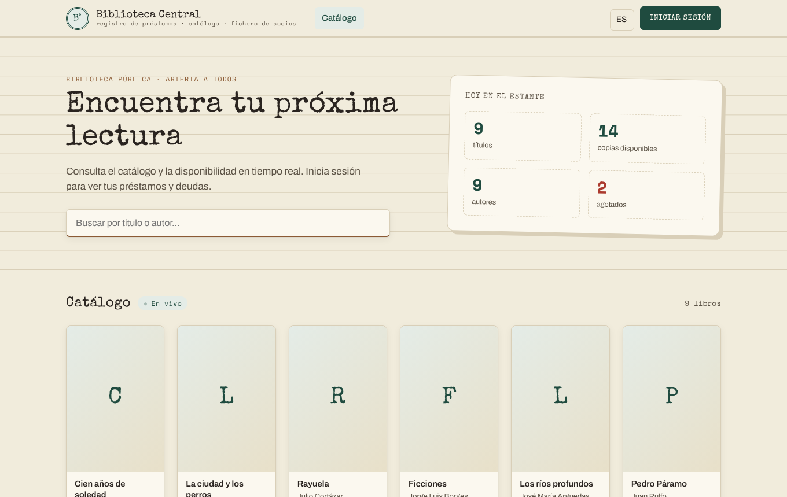

Móvil — inicio público:
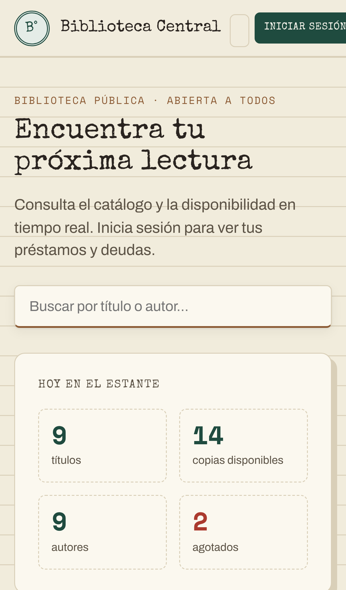

Inicio de sesión (escritorio y móvil):
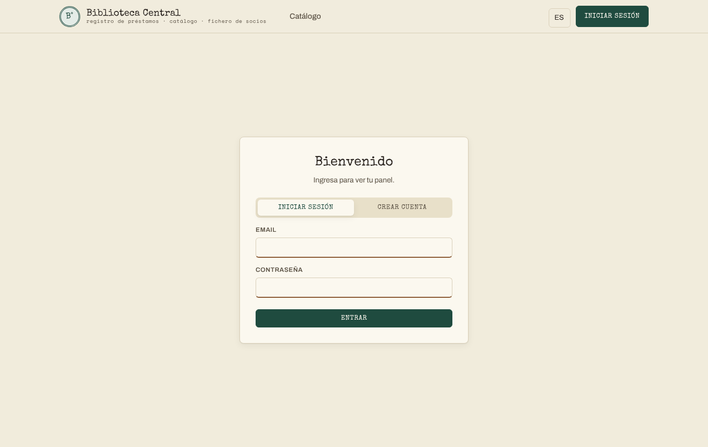
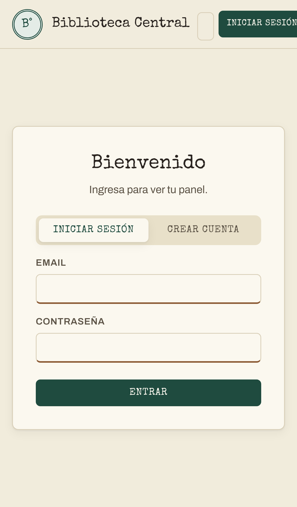

Panel del socio (escritorio y móvil):
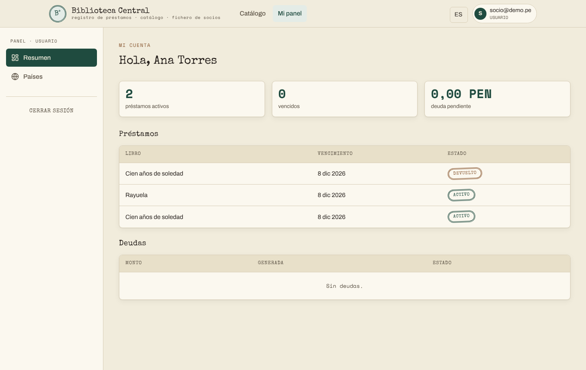
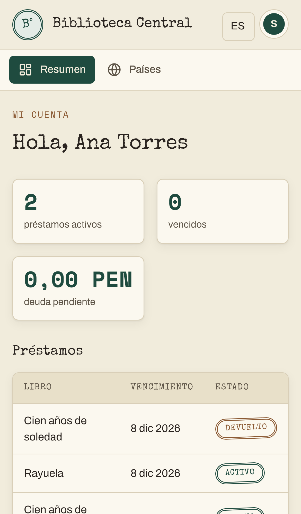

Panel del administrador:
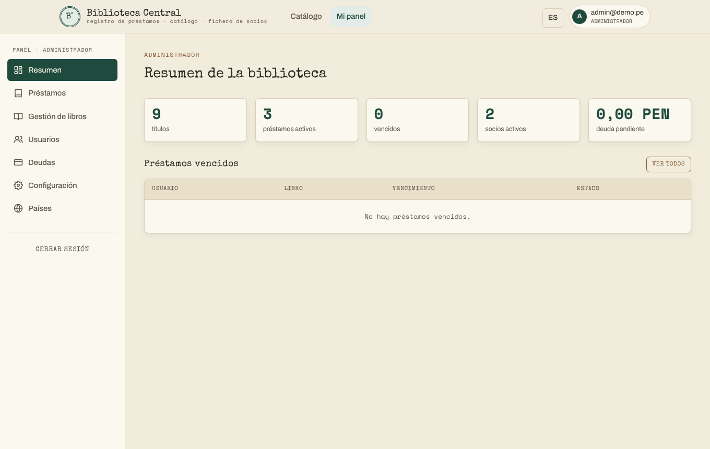
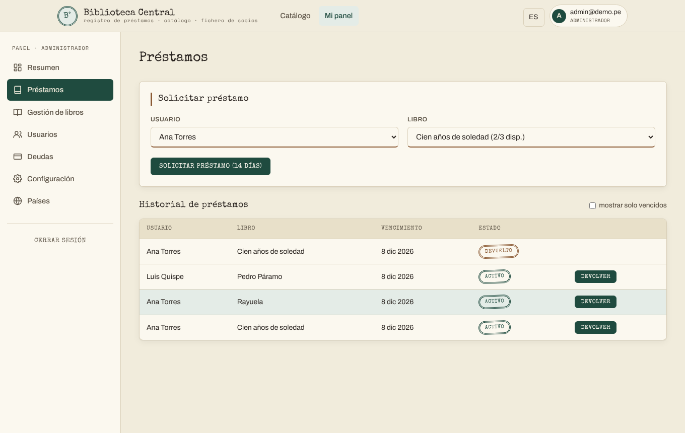
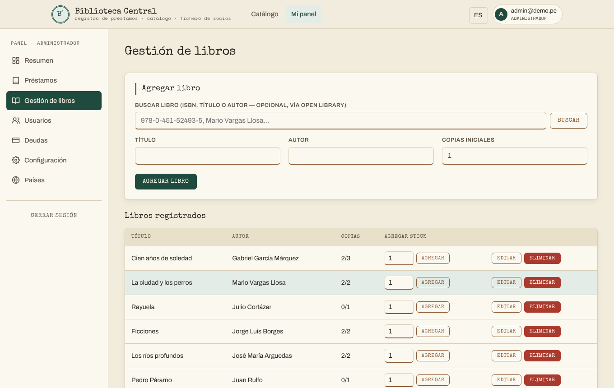
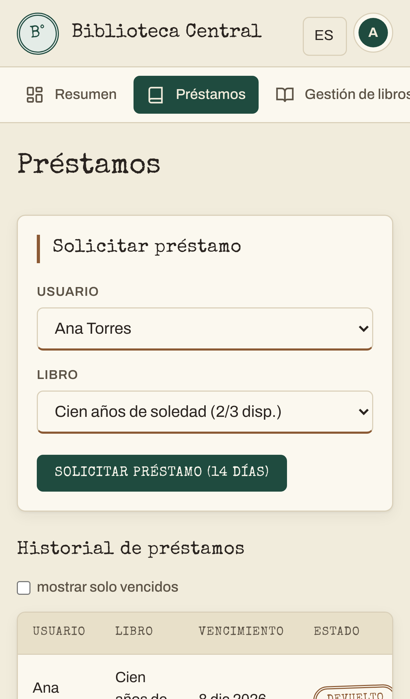

Árabe (RTL):
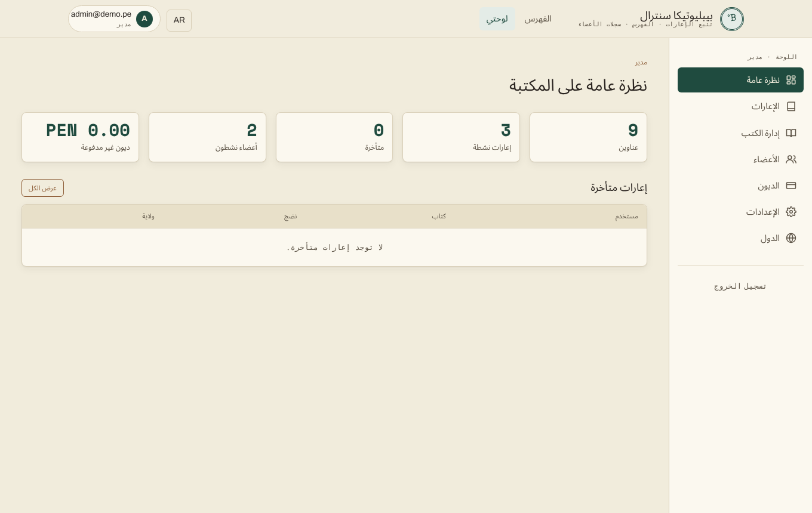
