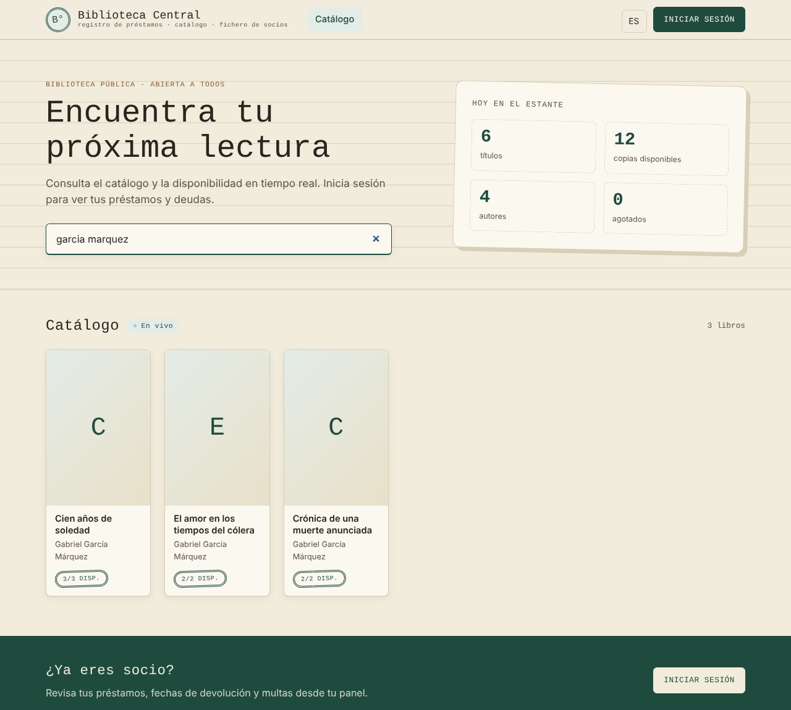

# Web Worker en la búsqueda del Catálogo

Actividad del curso: *Web Workers*. Se hizo primero aislada y luego se aplicó
al proyecto: el filtrado del catálogo corre en un **Web Worker** para que
escribir en el buscador no congele la página aunque el catálogo crezca.

Desde el rediseño del frontend, el buscador está en la **portada pública**
(`#/`), así que cualquier visitante lo usa sin iniciar sesión.

- Sitio: <https://biblioteca-central.readuls.workers.dev> (buscador "Encuentra tu próxima lectura").
- Código: [`frontend/catalogWorker.js`](../frontend/catalogWorker.js) (worker),
  [`frontend/catalog.js`](../frontend/catalog.js) (lógica de filtro) y
  [`frontend/app.js`](../frontend/app.js) (sección "Catálogo").

## Cómo funciona

```
app.js (hilo principal)                catalogWorker.js (hilo aparte)
───────────────────────                ─────────────────────────────
loadCatalog()  (GET /api/v1/books)
  └─ {type:"set", books} ─────────────▶ guarda los libros
input #catalogSearch
  └─ {type:"filter", id, query} ──────▶ Catalog.filterBooks(books, query)
renderCatalogGrid(books) ◀── {id, books} ┘
```

- El worker reutiliza `catalog.js` con `importScripts`, así la lógica de filtro
  es la misma en los dos hilos (y está probada con `node --test`).
- El catálogo se envía **una sola vez** por carga (`set`); cada tecla solo
  manda el texto (`filter`), no la lista completa.
- Cada búsqueda lleva un `id`: si llegan respuestas de teclas anteriores, se
  descartan y solo se pinta la última.
- Si el navegador no soporta `Worker`, se filtra en el hilo principal.
- Cuando el catálogo cambia en vivo (WebSocket), se vuelve a cargar y se
  reenvía al worker con `set`.
- La búsqueda ignora tildes y mayúsculas: `garcia marquez` encuentra
  "Gabriel García Márquez".

## Evidencia (24/11/2026)

- `npm test` en `frontend/`: **39 pruebas OK**, incluida una que ejecuta
  `catalogWorker.js` y verifica que responde el filtro con su `id`.
- Prueba en navegador (Playwright contra el backend local con 6 libros): el
  navegador registra el worker `http://localhost:3000/catalogWorker.js` y la
  búsqueda `garcia marquez` en la portada deja **3 tarjetas** de 6.



Para verlo en el sitio publicado: abrir la portada, F12 → pestaña *Sources*
(o *Depuración*) → aparece `catalogWorker.js` como hilo aparte; escribir en el
buscador y el filtrado ocurre sin bloquear la página.
