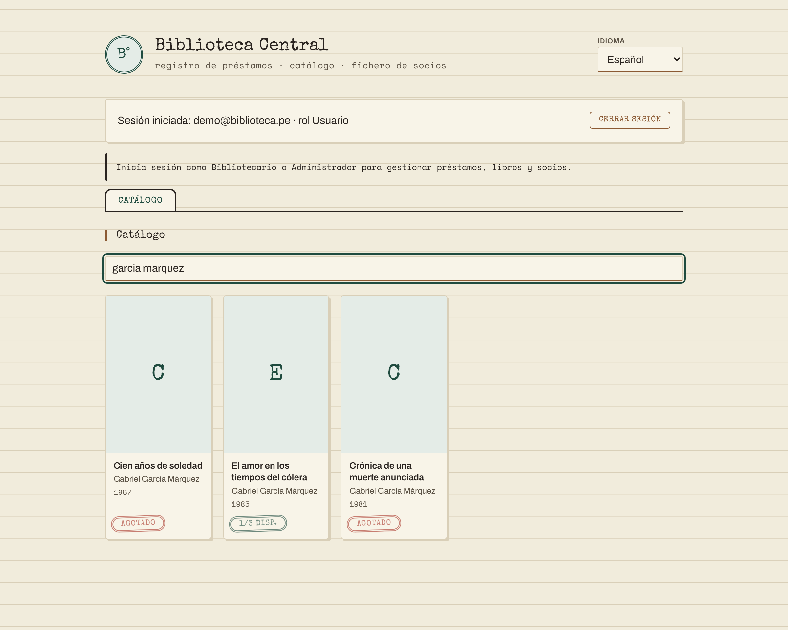

# Web Worker en la búsqueda del Catálogo

La actividad de *web workers* se hizo primero aislada; aquí se aplica al
proyecto: el filtrado del Catálogo corre en un **Web Worker** para que escribir
en el buscador no congele la página aunque el catálogo crezca.

## Cómo funciona

```
index.html (hilo principal)            catalogWorker.js (hilo aparte)
──────────────────────────             ─────────────────────────────
loadCatalog() ── {type:"set", books} ─▶ guarda los libros
input del buscador
  └─ {type:"filter", id, query} ──────▶ Catalog.filterBooks(books, query)
renderCatalogGrid(books) ◀── {id, books} ┘
```

- El worker reutiliza `catalog.js` con `importScripts`, así la lógica de filtro
  es la misma (y está probada con `node --test`).
- El catálogo se envía **una sola vez** por carga (`set`); cada tecla solo
  manda el texto (`filter`), no la lista completa.
- Cada búsqueda lleva un `id`: si llegan respuestas de teclas anteriores, se
  descartan y solo se pinta la última.
- Si el navegador no soporta `Worker`, se filtra en el hilo principal como antes.
- Mejora de paso: la búsqueda ignora tildes (`garcia marquez` encuentra
  "Gabriel García Márquez").

## Evidencia

- `npm test` en `frontend/`: 31 pruebas OK, incluida una que ejecuta
  `catalogWorker.js` y verifica que responde el filtro con su `id`.
- Prueba en navegador (Playwright, API simulada): el navegador registra el
  worker `catalogWorker.js` y la búsqueda `garcia marquez` deja 3 tarjetas.


