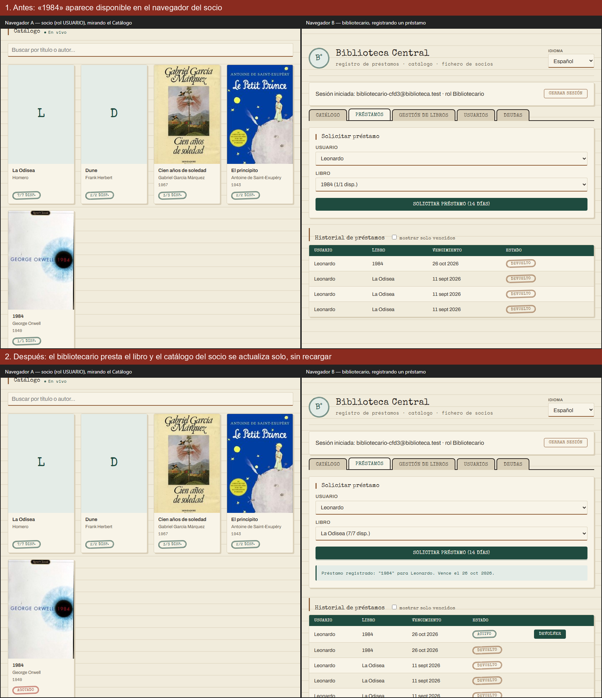

# WebSockets — Catálogo en vivo

Documento de entrega. Se agregó un WebSocket para que la **disponibilidad
de los libros del Catálogo se actualice en tiempo real** en todos los
navegadores abiertos, sin recargar la página.

---

## 1. Para qué se usa en la aplicación

El Catálogo muestra cuántas copias de cada libro están disponibles
(`2/3 disp.`, `Agotado`). Antes ese dato se pedía una sola vez, al entrar:
si un bibliotecario prestaba la última copia de un libro, un socio que ya
tenía el Catálogo abierto lo seguía viendo como disponible hasta recargar,
y podía ir al mostrador a pedir un libro que ya no estaba.

Ahora, cuando alguien del personal **presta, recibe una devolución, agrega
stock, edita o elimina un libro**, el servidor avisa por WebSocket a todos
los navegadores conectados y cada uno refresca su Catálogo al instante. La
etiqueta **● En vivo** junto al título indica que la conexión está activa.

**Captura — dos navegadores a la vez; el de la izquierda (socio) no se toca:**



Arriba, «1984» figura como `1/1 disp.` para el socio. Abajo, el
bibliotecario registra el préstamo en su navegador y la tarjeta del socio
cambia sola a `Agotado`.

## 2. Cómo funciona

```
Navegador B (bibliotecario)            Backend (Express + ws)             Navegador A (socio)
        │  POST /api/v1/loans  ───────────►│                                      │
        │◄─────────── 201 Created ─────────│                                      │
        │                                  │── WebSocket: {"type":"catalog-changed"} ──►│
        │                                  │◄──────── GET /api/v1/books (con token) ────│
        │                                  │──────────── libros actualizados ──────────►│
```

- **Servidor** — `backend/src/presentation/realtime/catalogSocket.ts`
  (librería [`ws`](https://github.com/websockets/ws)). El WebSocket vive
  en `/ws`, en el mismo puerto que la API. Un middleware de Express
  observa cada petición: si es una escritura (`POST`/`PUT`/`DELETE`) sobre
  `/books` o `/loans` y terminó bien, envía el aviso a todos los clientes
  conectados. Los controladores y servicios no se tocaron.
- **Cliente** — `connectLive()` en `frontend/index.html`, con el
  `WebSocket` nativo del navegador (sin librerías). Al recibir el aviso
  llama a `loadCatalog()`. Si la conexión se cae, se reconecta sola cada
  3 segundos y vuelve a pedir el catálogo por si se perdió algún cambio.
- **Seguridad** — el mensaje **no lleva datos**, solo dice "algo cambió".
  Los libros se siguen pidiendo por la API con el token de sesión, así
  que por el socket no se puede leer ni modificar nada.

## 3. Cómo probarlo

1. Abrir la app en dos navegadores (o una ventana normal y una de
   incógnito) e iniciar sesión: en uno como socio, en otro como
   bibliotecario.
2. En el del bibliotecario, ir a **Préstamos** y registrar un préstamo.
3. Mirar el Catálogo en el otro navegador: la disponibilidad del libro
   cambia sin tocar nada.

Prueba automática: `backend/src/presentation/realtime/catalogSocket.test.ts`
(`npm test` en `backend/`) levanta un servidor, conecta un WebSocket y
verifica que solo llega el aviso cuando una escritura de libros/préstamos
termina bien (no en lecturas, errores ni otras rutas).

## 4. Limitaciones conocidas

- Los clientes conectados se guardan en la memoria del proceso, así que
  funciona con **una sola instancia** del backend. Si Cloud Run escalara a
  varias, el aviso solo llegaría a los navegadores conectados a la misma
  instancia; la solución sería repartirlo con `LISTEN/NOTIFY` de Postgres.
- Cloud Run corta las conexiones largas al llegar a su tiempo máximo de
  petición; por eso el cliente se reconecta solo.
- Solo se refresca el Catálogo. Las tablas de gestión (Préstamos, Deudas)
  de otro bibliotecario conectado siguen actualizándose con sus propias
  acciones, como antes.
